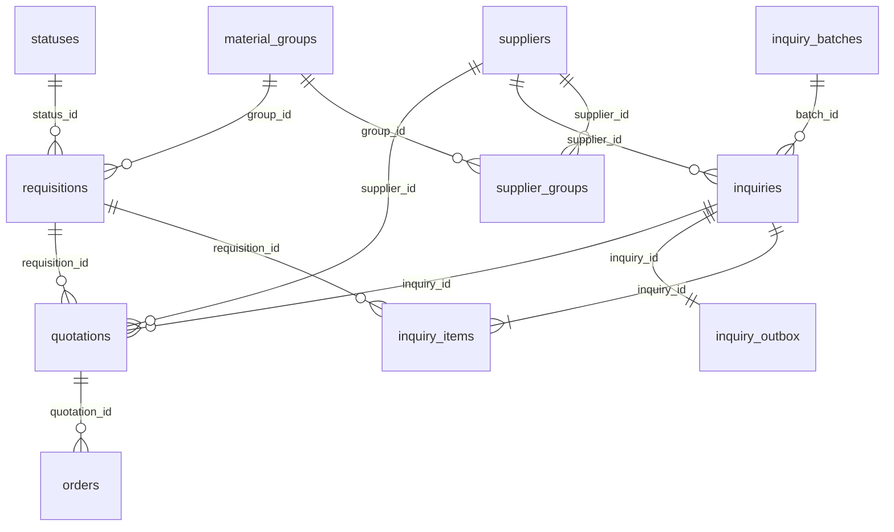

# 采购数据库

采购SQLite数据库已接入邮件Agent的收发循环。控制邮箱直接用自然语言请购、查询业务记录或与模型邮件问答；允许动作和采购规则放在config.yml。明确请购请求及合法附件触发供应商匹配和自动询价；供应商回传询价单后校验入库。历史JSON归档保留原存储。操作及回信格式见`templates/使用说明.md`。

## 选择与部署

采用 SQLite 作为采购业务主库。供应商、物料分组、供货关系、请购单、报价及订单使用关系表，外键约束关联，事务保证整批写入成功或回滚。JSON 只用于保留原始行及验证报告。

第一阶段部署方案：一台 Linux 云主机、一个收发邮件实例、挂载本机持久化磁盘。数据库文件位于 `data/procurement.sqlite3`；容器运行时把 `data/` 挂载为持久卷。启用 WAL、外键和 15 秒锁等待；所有连接通过 `Database` 创建。不要让多台机器直接打开网络共享盘上的同一 SQLite 文件。计划部署多副本、需要大量并发写入时，改用 PostgreSQL，再实现相应迁移和数据层。

这些边界与 SQLite 官方的 [适用场景](https://www.sqlite.org/whentouse.html) 和 [WAL 文档](https://www.sqlite.org/wal.html) 一致。主库不是一个需要单独启动的数据库服务；本模块没有新增 ORM、Redis 或任务队列。

## 已导入数据

| 业务表 | 物理表 | 记录数 |
| --- | --- | ---: |
| 供应商表 | `suppliers` | 100 |
| 物料分组表 | `material_groups` | 32 |
| 供应商-物料分类-对应表 | `supplier_groups` | 133 |
| 状态表 | `statuses` | 7 |
| 请购单表 | `requisitions` | 0 |
| 报价单表 | `quotations` | 0 |
| 订单表 | `orders` | 0 |

请购单源文件的 90 条记录按本次要求排除。报价单和订单源文件只有表头，因此已创建完整表结构，没有虚构业务记录。其他六个源文件的名称、内容哈希、行数、导入时间均在 `import_files` 中。

所有原始文件只读，未修改原有 `inquiry.sqlite3`。32 个分组都有供应商对应关系，供应商邮箱无重复。

## 表结构与关联

完整 DDL 见 `procurementdb/schema.sql`。七张业务表均提供同名中文只读视图，列名及列顺序与提供的七份源文件相同，例如：

```sql
SELECT * FROM "供应商表";
SELECT * FROM "请购单表";
SELECT * FROM "报价单表";
```



十张辅助表用于导入溯源、询价、邮件和数据维护：原有`import_files`、`inquiry_batches`、`inquiries`、`inquiry_items`、`inquiry_outbox`、`mail_messages`、`mail_cursors`、`runtime_metadata`，另加`data_update_requests`和`data_update_changes`记录业务更新请求及每条旧值/新值。总计17张物理表，当前schema版本为3。

- `supplier_groups` 的联合主键为供应商编号和物料分组编号，支持多对多供货关系。
- 请购单一行对应一个唯一编号，保留源文件全部 14 列，包括归集项目、物料编码、历史供应商。
- 报价保留原表全部11列。正式询价模板明确约定“报价价格”为每申请单位单价，用含税标识和税率说明税费口径，保存为 `price`；本轮不做比价计算或自动下单。订单的“订单单价”独立保存为 `unit_price`。
- 订单必须引用属于同一请购单、同一供应商的报价，不能错配其他供应商的报价。
- 数量、价格及税率使用精确十进制字符串；Python 用 `Decimal` 校验，避免浮点误差。SQL 查询展示的是字符串；后续金额运算也应使用 `Decimal`。
- 税率接受 `13%` 或 `0.13`，存为 `0.13`；裸值 `13` 拒绝。含税标识统一存为 1/0，空白保持空值。
- 请购日期规范化为 ISO 格式；报价“交货期”和订单“订单交货期”按原文保存，可以是日期，也可以是“7个工作日”等表述。
- 主数据及成功导入的业务行在 `source_json` 中保留原始单元格。相同编号、相同内容重复导入不新增；相同编号而内容不同会报冲突，不覆盖已有业务。

## 已实现的流程

1. 导入经授权的请购单 CSV/XLSX，校验表头、编号、数量、分组、状态及公式。附件提取不完整时拒绝整批导入。
2. 用 `v_requisition_suppliers` 自动联查物料分组对应的供应商及邮箱。一张请购单可以询多家，一家供应商可以收到多个适配物料；不同供应商收到各自的物料清单。
3. 创建一个请求批次，并为每个供应商分配独立询价编号，例如 `RFQ-20261031-12AB34CD56EF`。按原请求键重试，不重复创建询价。
4. 发件主题固定为 `[询价编号:RFQ-…] 物料询价`。正文要求供应商直接回复，保留原标题及询价编号。附件为20列询价单，前12列为编号及需求信息，后8列由供应商报价；入库仍映射到原报价单的11列。
5. 发件队列保存稳定的 `Message-ID`、收件人、正文和 CSV 附件。邮件适配器确认 SMTP 接受之后，才能调用 `mark_sent` 转入待报价。创建待发记录本身不会变更请购单为已询价。
6. 来信通过询价编号或 `In-Reply-To` / `References` 识别对应询价，同时核对实际发件地址、询价的收件地址及服务器收信时间。`Re:`、`回复:` 等前缀不影响编号提取。编号和回复头冲突、多个询价编号、错供应商、旧来信或普通回信进入 `needs_review`，不会作为有效报价入库。
7. 报价表中每行的供应商编号及请购单编号必须属于该询价。整封报价原子入库，任一行错误整批回滚，并保留来信元数据及错误原因。按账号和稳定邮件键去重；建议邮件键沿用原始 MIME 的 SHA-256。
8. 一份询价可以分次报价；只有每个受邀供应商都对某条请购单提交有效报价，该请购单才从 20“待报价”转为 30“待下单”。本轮不创建订单、不自动选供应商。

修订报价应使用新的报价单编号；同编号不同价格会报冲突，保留旧版本。供应商邮箱采用完整地址匹配，不删除 `+supplier001` 等子地址标签。一个数据库对应一个实际发件账号，切换账号应使用独立数据库。

## 邮件 Agent 接入

已实现：

- 当前自然语言模式从config.yml读取白名单和允许动作，正文不需要口令。模型识别请购、查询、问答或澄清；明确请购并有合法附件才原子导入请购单并准备询价。附件不能更改路由，重复提交不重复发信。旧structured兼容模式才使用正文口令。
- IMAP归档事件接到报价导入接口，使用服务器INTERNALDATE、实际From和回复头。即使 `keep_originals=false`，也可从已归档的完整表格提取结果重建业务CSV。自动回执、退信和邮件列表不触发采购报价。
- SMTP适配器使用SQLite中固定的收件人、正文、CSV附件和Message-ID，每轮最多发送10封。发送成功才转待报价；中断恢复为uncertain，不自动重发。控制者被移出白名单后，取消其未发询价。
- 采购主库绑定一个实际邮箱账号；历史控制邮件不补触发。启用和暂停通过本地维护命令操作。
- 报价成功或待核对会向控制者发送回执，发送异常同样反馈。错误报价保留在原邮件归档的表格提取内容中，供应商可用一封新的更正邮件重新提交。

`needs_review`和`uncertain`暂需人工核对，目前没有新增网页编辑或人工重试界面。采购流程不依赖AI解析价格；普通邮件AI摘要和通用任务继续保留原有行为。供应商完整子地址不合并为基础邮箱。

## 常用命令

在 `email-agent-lite` 目录、使用已安装项目依赖的 Python 执行：

```powershell
# 建表并导入六份非请购单来源；可重复执行
python procurement_db.py init --source-dir "./source-data"

# 查看记录数及数据库检查
python procurement_db.py status
python procurement_db.py check

# 后续显式导入一份请购单；本次交付库没有运行这条命令
python procurement_db.py import-requisitions "请购单.csv"

# 联表查询和准备待发询价；prepare 不会实际发邮件
python procurement_db.py candidates 20261030AL
python procurement_db.py prepare --request-key "control-message-sha256" 20261030AL

# 在线一致性备份，目标须为新文件
python procurement_db.py backup "backups/procurement-20261031.sqlite3"

python -m unittest discover -s tests -v
```

需要指定其他数据库时，使用全局参数，例如 `python procurement_db.py --db data/test.sqlite3 status`。数据库运行时不要只复制主文件作为备份：WAL 中可能还有已提交事务，使用上述 backup 命令。凭据不进入采购数据库；沿用现有 `config.yml` 管理。

## 本次验证

目前158项测试全部通过，涵盖数据库、采购邮件、主题和正文自然语言请求、只写主题的查询/问答/请购/更新、审计、回滚、权限、重复处理及SMTP异常。真实模型在隔离副本中按原供应商附件完成100条邮箱更新验证，只修改指定邮箱列，保留公司名、称呼及既有询价快照。

控制邮箱的`update_data`动作可修改七张业务表中的受支持字段；不执行模型生成的SQL，不新增或删除记录。已有关联询价的请购需求和已被订单引用的报价限制直接修改。每封更新邮件一个事务，所有值校验后写入并回读，保存控制者和源邮件供审计。供应商更新仅影响后续询价路由。

在临时副本中导入真实请购单的 90 行，得到 496 条请购单—供应商对应关系，90 条均匹配到供应商，按供应商归并为 94 封待发询价。使用一封生成的报价模板做合成回信验证，5 条报价成功入库。以上均为离线调用，没有 SMTP 发件或真实邮箱监听；合成报价和请购单均未写入交付主库。七个原始文件的 SHA-256 前后相同。

机器可读结果见 `procurementdb/verification.json`。交付主库 `integrity_check=ok`，`foreign_key_check` 无错误。
